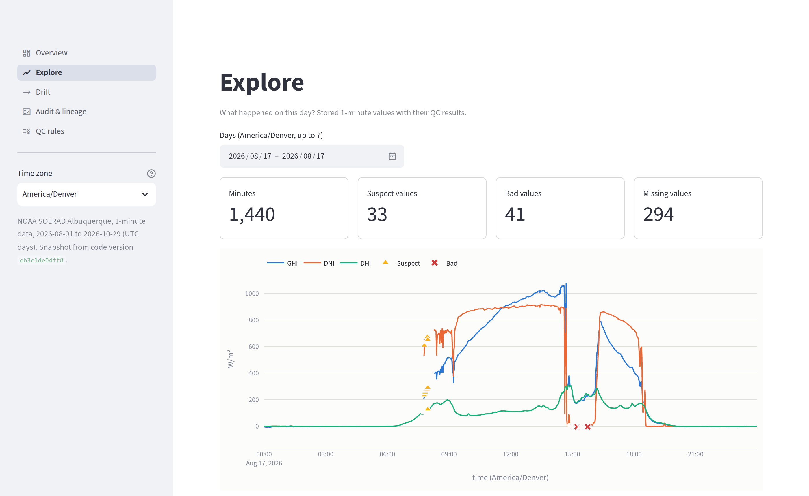

# ABQ Solar QC

A data pipeline that checks the quality of 1-minute solar irradiance data from NOAA's SOLRAD station in Albuquerque, and records where every value came from. Lab staff review the results in a read-only dashboard.

**Live dashboard:** _link added after deploy_



## What it does

- **Ingests** NOAA's daily files (GHI, DNI, DHI and UVB, one row per minute) with Dagster, one partition per UTC day, and keeps each raw file unchanged under its SHA-256 hash.
- **Runs 5 QC rules** based on BSRN practice (physical limits, closure, gaps, stuck values, calibration drift) and stores a flag for every failure. Nothing is deleted.
- **Traces every value** to the exact file and line it came from, the Dagster run that loaded it, and the git commit that ran.
- **Keeps an audit log** that is only ever added to. A hash chain makes any edit or deletion detectable.
- **Takes manual overrides** from a CSV reviewed through git, so a person can accept a false alarm or mark known-bad data with a reason and their name.
- **Serves a Streamlit dashboard** for lab staff: data availability, QC flags on the 1-minute data, a drift trend, a lineage lookup, and CSV export.

Data: Aug 1 – Oct 29, 2026, 90 days, 129,600 minutes. NOAA hadn't posted Oct 30 and 31 by Nov 1.

## Quick start

Needs [uv](https://docs.astral.sh/uv/), make and git. uv installs Python 3.12 if needed.

```bash
make setup      # install dependencies
make app        # dashboard at http://localhost:8501, reads the committed snapshot
```

To run the pipeline itself:

```bash
make dagster                                   # Dagster UI at http://localhost:3000
make backfill START=2026-08-01 END=2026-10-29  # download and process a date range (stop `make dagster` first)
make snapshot                                  # export the database to snapshot/ for the dashboard
make test                                      # pytest
make lint                                      # ruff
```

## How it works

### Pipeline

Each step is a Dagster asset, partitioned by UTC day unless noted:

1. `raw_solrad_file`: download the day's file, hash it, store it as-is.
2. `irradiance_1min`: parse it into typed rows, with lineage columns on every row.
3. `manual_overrides` (not partitioned): load `overrides/manual_overrides.csv`.
4. `qc_flags`: run the QC rules and apply the overrides.
5. `daily_summary`: availability, flag counts, clear-sky closure ratio, comparison with NOAA's own flags.
6. `drift_trend` (all days): 7-day median closure ratio against the August baseline.
7. `snapshot` (all days): Parquet export of every table, committed to git for the hosted dashboard.

**Asset checks** report pass or fail per day in the Dagster UI: station header, duplicate minutes, overrides CSV valid, audit chain intact, availability ≥ 95%, at most 10% of daytime minutes flagged, drift within ±2%, newest data no more than 3 days old.

A daily schedule (18:00 UTC) processes the day 2 days earlier, because NOAA posts files 1–2 days late. A separate freshness job (19:00 UTC) still runs if the daily one fails.

### QC rules

| Rule | Catches | Logic | Severity |
| --- | --- | --- | --- |
| `limits` | impossible values (wiring, logger faults) | BSRN physically possible limits, scaled by sun angle | bad |
| `closure` | one sensor disagreeing with the other two | GHI ≈ DNI·cos(zenith) + DHI, within ±8% (±15% near the horizon) | suspect |
| `gap` | missing data | a minute with no row, or NOAA's missing-value code | missing |
| `stuck` | a frozen sensor or logger | the same value for 10+ minutes while > 5 W/m² | suspect |
| `drift` | slow calibration change, tracker misalignment | 7-day median of the daily clear-sky closure ratio more than 2% from the August baseline | warning (per day) |

**The closure test is the key one.** The station measures total sunlight on a flat surface (GHI), the direct beam (DNI) and sky light (DHI) separately, and the first should equal the sum of the other two. When it doesn't, one sensor is off. Tracked over clear days, the same ratio shows slow calibration drift without needing calibration records.

Each rule has a version. Changing a threshold without bumping the version stops the pipeline, so every flag points to the exact thresholds that produced it.

### Traceability

- **Lineage:** every `measurements` row carries `source_sha256` + `source_line` (the raw file and line), `run_id` (the Dagster run) and `code_version` (the git commit). The dashboard's Audit & lineage page looks up any minute and links to the NOAA file.
- **Audit log:** events for file downloads, changed files, override loads, QC runs and applied overrides. Each is written in the same transaction as the data change it describes, and each stores the hash of the event before it.
- **Overrides:** an override never deletes an automatic flag. The dashboard shows the automatic flag, the override and the final status side by side. The repo ships one real override, `OVR-0001`: DNI readings of −4.5 to −12.4 W/m² under full overcast on Aug 1, which is the instrument's thermal offset, not a fault.
- **Snapshot integrity:** `snapshot/manifest.json` records each file's SHA-256 and row count plus the newest audit event's hash. The dashboard re-checks all of it on every load.

### Results, Aug 1 – Oct 29, 2026

- **99.57% of expected values arrived.** NOAA sent all 1440 rows every day, but 25 days have missing values inside those rows.
- **5.8% of daytime minutes flagged**, mostly closure failures under fast-moving monsoon clouds, when the three sensors briefly disagree.
- **Drift:** the 7-day clear-sky ratio stayed within −0.9% to +0.4% of the August baseline. No warnings.
- **Compared with NOAA's flags:** 1,933 sensor values flagged by both, 10,616 by us only, 3 by NOAA only. Most of the difference is the closure test, which marks all three sensors whenever they disagree by more than 8%.

## Repo layout

```text
src/abq_qc/        pipeline: parser, QC rules, database, Dagster assets
dashboard/         Streamlit app: app.py, views/ (one file per page), queries.py, charts.py
overrides/         manual_overrides.csv
snapshot/          Parquet export the dashboard reads (committed)
docs/              design doc, data dictionary, database choice
tests/             pytest, including two real NOAA files as fixtures
```

## Docs

- [Design doc](docs/design.md): scope, schema, every QC rule and the decisions behind it
- [Data dictionary](docs/data_dictionary.md): every table and column, with units
- [Database choice](docs/database_choice.md): why DuckDB here, and PostgreSQL / TimescaleDB in production

## Not included and why

| Left out | Why |
| --- | --- |
| Calibration records | Not publicly available for this station, and I'm not using dummy data. Drift is tracked from the measurements instead |
| Backup-sensor comparison | The station has one sensor per measurement |
| Temperature and wind QC | The station doesn't measure them |
| pvlib clear-sky model | Time. A simple clear-sky filter (low diffuse fraction) is enough for the drift check |
| UVB QC | Not central to solar resource data. Stored but not checked |
| PostgreSQL / TimescaleDB | DuckDB keeps hosting free and simple. See [database choice](https://github.com/anjahelfrich/abq-solar-qc/blob/main/docs/database_choice.md) |
| Scheduled runs in the hosted demo | Streamlit Cloud only hosts the app. The schedule runs locally |
| Editing flags in the dashboard, user logins | Overrides go through git instead |
| Docker | Time. `uv sync` already installs the exact versions in `uv.lock` |

## How I used AI

I built this with [Claude Code](https://claude.com/claude-code) as a pair programmer, over one weekend.

- **The split:** I chose the concept, the station, the tools and the scope, and approved the design doc (`docs/design.md`) before any code was written. Claude wrote the code, tests and docs to that spec in 7 steps. After each step I reviewed it, asked for explanations until I could explain it myself, and made the open calls before it was committed.
- **Where it helped most:** getting up to speed on the solar domain (BSRN QC practice, what the closure test means physically) and on Dagster and Streamlit, which I hadn't used before. My background is time-series PostgreSQL, sensor ingestion and Databricks.
- **Where my judgment mattered:**
  - **No dummy data.** Calibration records aren't public, so I left them out and said so above, rather than inventing a table that would look like real lab records.
  - **Tuning on real data.** The first version of the stuck rule flagged 861 DHI minutes. Looking at examples showed steady clear-sky diffuse light, not a frozen sensor, so I chose to skip DHI under clear sky (53 flags left). And from Aug 11, NOAA started writing the station's coordinates with 2 decimals instead of 5, which failed the header check; I approved widening its tolerance to 0.01° (about 1 km).
  - **What availability means.** NOAA sends every row, but some rows hold missing values. I decided the dashboard counts values, not rows, so those gaps show up.
  - **Audit design:** a hash chain on the audit log, and overrides reviewed through git rather than edited in the app.
- **How I checked the work:** each QC rule has tests with a case that should pass and one that should fail; two real NOAA files are test fixtures; CI runs lint and tests on every push. I also looked at the results on the full Aug–Oct backfill. That's how the stuck-rule and header-format problems surfaced, which the tests alone wouldn't have caught.
- **One thing that would have broken:** the hosted dashboard installs fewer packages than the pipeline. Before deploying, Claude installed only the hosted ones in a clean environment and found that two pages crashed, because a library DuckDB needs had only been arriving as part of Dagster. Now it's listed explicitly, and a test checks the two dependency lists match.

## Data source

NOAA Global Monitoring Laboratory, [SOLRAD network](https://gml.noaa.gov/grad/solrad/), station Albuquerque (`abq`): 35.04° N, 106.62° W, 1617 m. [Data files](https://gml.noaa.gov/aftp/data/radiation/solrad/abq/) and [field definitions](https://gml.noaa.gov/aftp/data/radiation/solrad/README_SOLRAD.txt).
