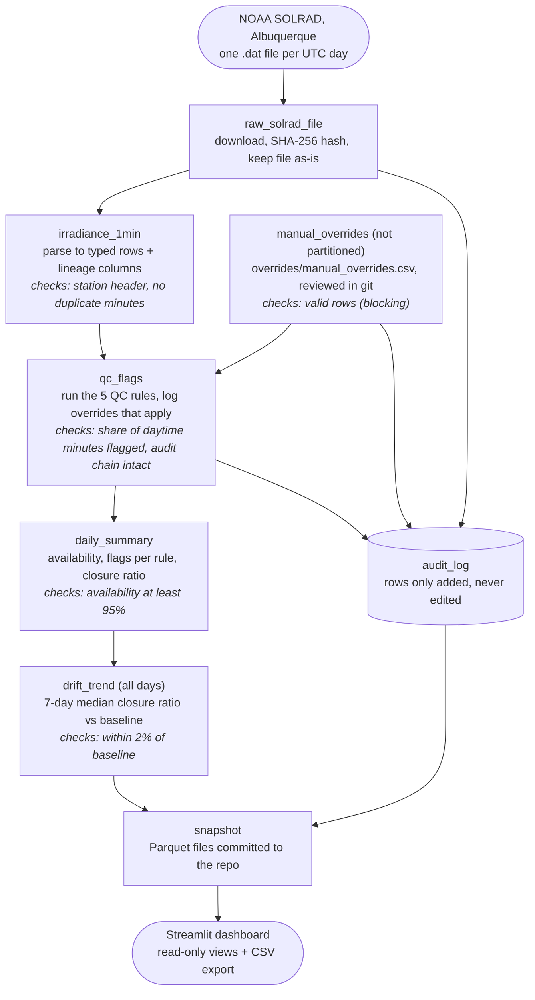

# ABQ Solar QC: Design Doc

Approved Nov 1, 2026 by Anja Helfrich.

## Goal and scope

A Dagster pipeline downloads NOAA's 1-minute solar irradiance files for Albuquerque and runs QC checks on them. It records where every value came from and serves the results to lab staff in a read-only Streamlit dashboard. Budget: one weekend, about 10–15 hours.

- **Readers:** lab staff and quality personnel use the dashboard. Reviewers read the repo and README.
- **In v1:**
  - daily ingest and backfill
  - 5 QC rules
  - lineage on every row
  - an audit log that is only ever added to, plus manual overrides
  - a dashboard with CSV export
  - tests and CI
  - a data dictionary and a note on the database choice
- **Kept simple on purpose:** one station, three months, one database file. Anything left out is listed under "Not included and why".

## Data source

The data is NOAA SOLRAD station Albuquerque (`abq`), 1-minute data from **Aug 1 to Oct 31, 2026**. That is day of year 213–304: 92 days, about 132,000 rows.

- **Files:** one per UTC day, at `https://gml.noaa.gov/aftp/data/radiation/solrad/abq/2026/abq26DDD.dat`, where DDD is the day of year. See the [data folder](https://gml.noaa.gov/aftp/data/radiation/solrad/abq/) and the [field definitions](https://gml.noaa.gov/aftp/data/radiation/solrad/abq/README_SOLRAD.txt).
- **Station:** 35.03796 N, 106.62211 W, 1617 m elevation.
- **Measured:**
  - global (GHI), direct normal (DNI) and diffuse (DHI) irradiance, in W/m²
  - UVB
  - the standard deviation of the 1-second samples behind each minute
  - NOAA's QC flag next to each value (0 = good)
- **Not measured:** air temperature, wind, backup sensors.

What the parser has to handle:

- **Missing minutes:** they are left out of the file instead of being filled with blanks. A full day has 1440 rows. Mar 4, 2026 (`abq26063.dat`) is a partial day we can use as a test file.
- **Timestamps:** each one marks the end of its 1-minute average. The zenith angle is calculated for the middle of the minute.
- **Small negative values at night:** GHI and DHI of 0 to −10 W/m² are normal, because the sensors cool by radiating heat to the sky.
- **Late files:** files appear 1–2 days late. On Nov 1 the newest file was Oct 29.

## Pipeline

Six daily Dagster assets carry each day's file from NOAA to the dashboard, and a seventh loads the manual overrides. Every step writes to the audit log alongside.



Each box in the middle column between NOAA and the dashboard is a **Dagster asset**: a stored table or file that Dagster knows how to build, along with the assets it depends on. The lines starting with "checks:" are **asset checks**, which show pass, warn or fail per day in the Dagster UI. The per-minute QC flags themselves live in the `qc_flags` table.

- **Partitions:** one per UTC day, starting Aug 1, 2026. Re-running a day replaces only that day's rows, so a run is safe to repeat. Audit events are never removed.
- **Backfill:** Aug 1 to Oct 31 in one go, from the Dagster UI or with `make backfill`.
- **Schedule:** daily at 18:00 UTC, processing the day from 2 days earlier, because NOAA posts files 1–2 days late. If the file isn't there yet, the run fails with a clear message and can be re-run.
- **Freshness check:** warns if the newest day is more than 3 days old. This catches a stalled pipeline or a NOAA outage. It runs as its own job at 19:00 UTC, because a check inside the daily run would be skipped when that run fails.

## Storage and schema

The pipeline writes all tables to one DuckDB file, and a Parquet copy of them is committed for the hosted dashboard. All times are stored in UTC.

**Why DuckDB:** it is a single file with no server, and it is fast at this size. Streamlit Cloud can read the Parquet copy without a hosted database. In production, with years of data from many stations and several users and services writing at once, I'd use PostgreSQL with time partitioning, or TimescaleDB. `docs/database_choice.md` explains this choice.

| Table | One row per | Main columns | Written by |
| --- | --- | --- | --- |
| `source_files` | downloaded file version | sha256, file_date, url, size_bytes, downloaded_at, run_id | raw_solrad_file |
| `measurements` | minute | ts_utc, ghi, dni, dhi, uvb, zenith_deg, std_\*, noaa_qc_\*, source_sha256, source_line, run_id, code_version | irradiance_1min |
| `qc_rules` | rule version | rule_id, version, description, thresholds, severity | loaded from code |
| `qc_flags` | rule failed for one variable (or `all`) at one minute | ts_utc, variable, rule_id, rule_version, severity, value, run_id | qc_flags |
| `overrides` | manual decision | override_id, start_utc, end_utc, variable, rule_id, action, reason, author, source_sha256, run_id | manual_overrides |
| `audit_log` | event | event_id, event_time, event_type, actor, details (JSON), run_id, prev_hash, event_hash | raw_solrad_file, manual_overrides, qc_flags |
| `qc_status` (view) | sensor value with a flag or override | ts_utc, variable, auto_rules, override_ids, final_status | computed when queried |
| `daily_summary` | UTC day | received_minutes, availability_pct, flags per rule, clear-sky closure ratio, NOAA agreement counts | daily_summary |
| `drift_trend` | UTC day | 7-day median closure ratio, baseline, deviation_pct | drift_trend |

- `measurements` is wide (one column per measurement) because the closure test compares GHI, DNI and DHI from the same minute.
- `qc_flags` holds only failures, which keeps it small: a minute with no rows there passed every rule. The exception is gaps: a missing minute gets a `gap` row even though it has no measurement.
- `variable` is `ghi`, `dni` or `dhi`, or `all` when the flag is about the whole minute: a closure failure (the test can't tell which sensor is wrong; `value` holds the ratio) or a missing minute. A row whose value is NOAA's missing value gets a `gap` flag for that variable only.
- Drift is not in `qc_flags`: it is per day and needs a 7-day window, so it lives in `drift_trend`.
- `qc_status` is a view, so the final status always matches the current flags and overrides. A value not listed there is good. Flags on `all` count for every sensor.
- The full column list with units is in `docs/data_dictionary.md`.

## QC rules

Five rules run on GHI, DNI and DHI. Flags mark data as questionable, and nothing is deleted. BSRN and NOAA work the same way. The thresholds below are starting values to tune once we've seen the data, and changing one bumps the rule's version.

| Rule | What it catches | Logic | Severity |
| --- | --- | --- | --- |
| `limits` | impossible values (wiring or logger faults) | BSRN "physically possible" limits. Upper: GHI ≤ Sa·1.5·μ0^1.2 + 100, DHI ≤ Sa·0.95·μ0^1.2 + 50, DNI ≤ Sa. Lower: −4 W/m² by day, −10 W/m² at night | bad |
| `closure` | one sensor disagreeing with the other two | GHI ÷ (DNI·cos Z + DHI) within ±8% for zenith < 75° and ±15% for 75–93°. Only applied when the sum > 50 W/m² | suspect |
| `gap` | missing data | an expected minute (1440 per day) with no row | missing |
| `stuck` | a frozen sensor or logger | the same value 10+ minutes in a row while > 5 W/m². DHI is skipped under clear sky (DHI/GHI < 0.2) | suspect |
| `drift` | slow calibration change or a misaligned tracker | daily median closure ratio on clear-sky minutes (zenith < 60°, DHI/GHI < 0.2). Warns when the 7-day rolling median is more than 2% from the August baseline | warning (per day, not per minute) |

Sa is the solar constant adjusted for the Earth–Sun distance: about 1361 W/m², varying ±3.4% over the year. μ0 is cos(zenith). "Daytime" means zenith < 90°.

The rules are pure functions in `src/abq_qc/qc_rules.py`. Each rule's thresholds sit next to its version number, and the pipeline refuses to run if a rule changed but kept its version, so a flag's `(rule_id, rule_version)` always points to one fixed set of thresholds.

Tuning after looking at Aug–Oct 2026 data (Anja, Nov 1, 2026):

- **Stuck:** the "1-second std dev of 0 while > 50 W/m²" condition was dropped. The std is reported in steps of about 0.084 W/m², so steady clear-sky DHI often reads 0 for 10+ minutes (23 of 89 days). A frozen logger repeats its value, which the 10-minute condition already catches.
- **Stuck v2 (step 5):** steady clear-sky DHI can stay within one logger step for up to 47 minutes (Sep 20: 58.1 W/m² from 17:02 to 17:48 UTC, while the sensor was clearly alive). v1 flagged 861 DHI minutes on 32 days, 808 of them under clear sky. v2 skips DHI when DHI/GHI < 0.2, leaving 53 flags on 5 days. GHI and DNI keep the full rule: they change minute to minute under clear sky. Where GHI is missing, clear sky can't be confirmed and DHI is still checked.
- **Closure on cloudy days:** fast-moving clouds fail closure on 5–16% of daytime minutes, because the three sensors respond at slightly different speeds and see slightly different parts of the sky. The rule stays at the BSRN limits; the asset check threshold below accounts for it.

**Why the closure test works:** GHI is the sum of direct sunlight on a flat surface (DNI·cos Z) and diffuse sky light (DHI). The station measures all three separately, so the sum is a built-in cross-check.

- A ratio that creeps **above 1** means DNI or DHI is reading low, for example because the tracker is slipping off the sun.
- A ratio **below 1** means GHI is reading low, or the diffuse sensor's shade is letting direct sun through.

**Comparison with NOAA (not a rule):** for each day, we count sensor values (GHI, DNI, DHI × minute) flagged by both, by us only, and by NOAA only. Only received rows count, since NOAA can't flag a minute that isn't in the file. Our side is the automatic flags, without overrides; a closure flag on `all` counts for all three sensors. The counts show in the dashboard. A big difference in either direction is worth a look.

**Dagster asset checks** are a health summary of the pipeline, shown as pass, warn or fail per day in the Dagster UI:

- the overrides CSV is valid (error, blocking): a typo stops QC instead of being silently ignored
- the audit log's hash chain is intact (error)
- the file header's latitude and longitude match the station within 0.01° (about 1 km), which catches format changes (error). From Aug 11, 2026, NOAA writes the coordinates with 2 decimals instead of 5, so a tighter tolerance fails on real files
- no duplicate minutes (error)
- availability ≥ 95% (warn)
- at most 10% of received daytime minutes flagged, gaps not counted (warn). On Aug 1–Oct 29 (90 days, stuck v2): with 5%, 46 days warn; with 10%, 15 days, mostly stormy monsoon days
- drift within ±2% (warn)
- freshness: the newest day is no more than 3 days old (warn)

## Traceability

Any value in the dashboard can be traced back to the exact line of the exact file it came from, the run that loaded it, and the code version that ran.

The lineage chain on every `measurements` row:

1. `source_sha256` + `source_line` point to a `source_files` row (URL, download time, file size).
2. `source_sha256` points to the raw file, kept unchanged under `data/raw/`.
3. `run_id` points to the Dagster run and its logs.
4. `code_version` is the git commit that ran.

Dagster's asset graph adds lineage at the table level: which asset was built from which.

**Audit log.** Rows are only ever added, never changed or deleted.

| Event | When | Details recorded |
| --- | --- | --- |
| `file_ingested` | a new file is downloaded | url, sha256, row count |
| `file_changed` | a re-download's hash differs from the earlier download | old and new sha256. Both versions are kept and the day is reprocessed |
| `overrides_loaded` | the overrides CSV changed since the last load | old and new sha256, override ids added, removed and changed |
| `qc_run` | QC runs for a day | rule versions used, flag counts per rule, sha256 of the overrides file in effect |
| `override_applied` | a manual override matches data in a QC run | override id, action, reason, minutes affected. `actor` is the override's author |

- DuckDB has no triggers, so the add-only rule is enforced in code: there is one write function (`append_audit` in `db.py`), it only inserts, and a test covers it. In PostgreSQL I'd remove UPDATE and DELETE permission on the table instead.
- **Hash chain:** each event stores the SHA-256 of its own content plus the previous event's hash. Editing or deleting an old row breaks the chain, and the `audit_chain_intact` check finds it. Removing the newest rows can't be detected from inside the table; the snapshot committed to git anchors the latest hash.
- An audit event is written in the same transaction as the data change it describes, so there's never one without the other.
- An override never deletes an automatic flag. The dashboard shows the automatic flag, the override, and the final status.

**Manual overrides** live in `overrides/manual_overrides.csv`, one row per decision:

| Column | Meaning |
| --- | --- |
| `override_id` | unique, e.g. `OVR-0001` |
| `start_utc`, `end_utc` | UTC with a `Z`, e.g. `2026-08-01T21:35:00Z`. Both minutes are included |
| `variable` | `ghi`, `dni`, `dhi`, or `all` (every sensor) |
| `rule_id` | for `accept`: `limits`, `closure` or `stuck`. Empty for `flag_bad` |
| `action` | `accept`: an automatic flag was reviewed and is a false alarm, so the final status is good. `flag_bad`: data known to be bad (e.g. maintenance), with or without an automatic flag |
| `reason`, `author` | required |

- Gaps can't be accepted: there is no value to keep.
- A flag on `all` (closure) can only be accepted by an override on `all`.
- To apply a changed CSV: commit it, then re-run `manual_overrides` and the affected days of `qc_flags`.
- The repo ships one real override, `OVR-0001`: the 23 DNI `limits` flags on Aug 1, 21:35–23:17 UTC (−4.5 to −12.4 W/m² under full overcast, GHI ≈ DHI). That's the pyrheliometer's thermal offset, not a fault.

## Dashboard

The dashboard is a read-only Streamlit app that reads the committed Parquet snapshot. Lab staff can explore and export data without database access. Times are stored in UTC. A time zone picker sets the zone for charts, tables and downloads; it defaults to Mountain time (America/Denver). Downloads always include a UTC column as well.

| Page | Shows | Answers |
| --- | --- | --- |
| Overview | tiles for availability %, days with gaps, % of daytime minutes flagged, and newest data date; availability and flags per day | Is the data OK? |
| Explore | GHI, DNI and DHI for a chosen date range with flagged minutes marked; a flag table; CSV export with flags and lineage columns | What happened on this day? |
| Drift | daily clear-sky closure ratio, its 7-day median, and the ±2% band | Are the sensors and tracker holding calibration? |
| Audit & lineage | the audit log; look up a minute to see its source file, hash, line, run, commit, and a link to the NOAA file | Where did this value come from? |
| QC rules | the rule table with versions, the NOAA comparison, and "Not included and why" | How do the checks work? |

## Repo, tests, CI, hosting

The project uses Python 3.12, managed with uv. Main libraries: dagster, duckdb, pandas, streamlit and plotly, with pytest and ruff for checks. v1 doesn't need pvlib, because the file already includes the zenith angle.

```text
abq-solar-qc/
  src/abq_qc/
    parse.py           SOLRAD file -> typed rows
    qc_rules.py        one pure function per rule
    db.py              schema, qc_status view, add-only audit writer + hash chain check
    overrides.py       read, validate and load the overrides CSV
    assets/            Dagster assets and asset checks
    definitions.py     Dagster entry point, schedule
  dashboard/           Streamlit app: app.py, views/ (pages), queries.py, charts.py
  overrides/manual_overrides.csv
  snapshot/            Parquet files (committed)
  data/                raw files + DuckDB (gitignored)
  docs/                design, data dictionary, database choice
  tests/fixtures/      real NOAA files: one full day + the Mar 4 partial day
  Makefile  pyproject.toml  .github/workflows/ci.yml  README.md
```

- **Tests:**
  - the parser on the two real files
  - each QC rule on small hand-made cases, one that should pass and one that should fail
  - re-running a day adds audit events and never changes old ones
  - one end-to-end run of a single day
- **CI:** GitHub Actions runs ruff and pytest on every push.
- **Make targets:** `make setup`, `make dagster` (opens the Dagster UI), `make backfill`, `make snapshot`, `make app`, `make test`.
- **Hosting:** Streamlit Community Cloud, deployed from the public GitHub repo. The daily schedule runs locally, and the hosted app shows the last committed snapshot. Streamlit Cloud installs `dashboard/requirements.txt` (no Dagster), not the root `uv.lock`.

## Not included and why

This list also goes in the README, so reviewers see what was left out on purpose. The README is the source: the dashboard's QC rules page renders its section from there.

| Left out | Why |
| --- | --- |
| Calibration records | Not publicly available for this station, and we're not using dummy data. Drift is tracked from the measurements instead |
| Backup-sensor comparison | The station has one sensor per measurement |
| Temperature and wind QC | The station doesn't measure them |
| pvlib clear-sky model | Time. A simple clear-sky filter (low diffuse fraction) is enough for the drift check |
| UVB QC | Not central to solar resource data. Stored but not checked |
| PostgreSQL / TimescaleDB | DuckDB keeps hosting free and simple. The production choice is explained in `docs/database_choice.md` |
| Scheduled runs in the hosted demo | Streamlit Cloud only hosts the app. The schedule runs locally |
| Editing flags in the dashboard, user logins | Overrides go through git instead |
| Docker | Time. `uv sync` already installs the exact versions in `uv.lock` |

## Build order and decisions

The build order below adds up to about 13.5 hours. The hours are rough estimates.

1. Scaffold: uv project, CI, parser and its tests (2 h)
2. Ingest assets, DuckDB schema, lineage columns (2 h)
3. QC rules and their tests, asset checks (3 h)
4. Audit log and overrides (1.5 h)
5. Daily summary, drift trend, snapshot, Aug–Oct backfill (1 h)
6. Streamlit dashboard (2.5 h)
7. README with the "how I used AI" section, data dictionary, database-choice note, deploy (1.5 h)

Decisions on the open questions (Anja, Nov 1, 2026):

- **Manual overrides:** a CSV in the repo, changed through git commits. The commit history is the reviewed record of who changed what and why.
- **Time zone:** store in UTC. The UI has a time zone picker for charts, tables and downloads, and downloads also include UTC.
- **Drift baseline:** the August median, with a warning at ±2%, as a starting point.
- **Repo name:** `abq-solar-qc`, for both the local folder and the GitHub repo.
- **This doc:** copied into the repo as `docs/design.md`.

Step 4 decisions (Anja, Nov 1, 2026):

- **Override actions:** `accept` and `flag_bad`.
- **Overrides CSV:** its own unpartitioned asset, `manual_overrides`, with a blocking validity check.
- **Audit log:** hash chain for tamper evidence, plus the `overrides_loaded` event.
- **Example data:** ship one real override (`OVR-0001`) from reviewing Aug 1.

Step 5 decisions (Anja, Nov 1, 2026):

- **NOAA comparison:** per sensor value, received rows only, automatic flags only.
- **Freshness check:** its own job and schedule (19:00 UTC), so it still runs when the daily pipeline fails.
- **Drift check:** judges the newest day that has a 7-day median. Past days outside the band are listed in the check's metadata and on the Drift page.
- **Stuck rule v2:** skip DHI under clear sky (DHI/GHI < 0.2). See the tuning notes under QC rules.
- **Header check tolerance:** 0.01°, after NOAA's switch to 2-decimal coordinates.
- **Snapshot:** `snapshot/<table>.parquet`, one file per table (`qc_status` written as a table), rows sorted, plus `manifest.json` with row counts, a SHA-256 per file, the code version and the newest audit event's hash. No wall-clock time in it, so writing unchanged data gives byte-identical files.

Defaults chosen while building step 5:

- **Baseline:** median of the Aug 1–31, 2026 daily ratios that exist. No August data means no baseline, and the drift check fails.
- **Jobs:** `daily_pipeline` (all assets, one partition, scheduled 18:00 UTC for the day 2 days earlier) and `freshness` (only the freshness check). Dagster starts schedules switched off; turn them on in the UI.
- **`make backfill`:** loads the overrides once, runs each day's ingest → QC → summary, then rebuilds `drift_trend` once. Runs are recorded in the local Dagster instance, so they show in the UI. Writing the snapshot is its own step (`make snapshot`), because it changes files in the repo.

Step 6 decisions (Anja, Nov 1, 2026):

- **Data access:** an in-memory DuckDB with one view per Parquet file; pages query it with SQL.
- **Explore range:** up to 7 days, always the stored 1-minute values. Defaults to the newest day.
- **Audit page:** recomputes the snapshot's integrity on every load (each file's SHA-256 and row count against `manifest.json`, the audit hash chain, the newest event against the manifest).
- **Overview:** availability with a 95% line, and % of daytime minutes flagged with a 10% line, matching the asset checks.
- **Availability counts values, not rows:** NOAA sent all 1440 rows on all 90 days, but 25 days have missing values inside those rows (NOAA's missing-value code; 938 GHI, 720 DNI, 8 DHI minutes). The dashboard counts sensor values (1440 × 3 per day) that arrived and aren't missing. The pipeline's `availability` check still counts rows received.

Defaults chosen while building step 6:

- **Layout:** `dashboard/app.py` (navigation and the sidebar time zone picker), `dashboard/views/` (one file per page; not `pages/`, which Streamlit would turn into its own navigation), `dashboard/queries.py` (all SQL, no Streamlit), `dashboard/charts.py` (plotly figures).
- **Time zones offered:** America/Denver (default), UTC, and the other US zones. Explore and lineage dates are picked as local calendar days.
- **CSV export:** one row per minute, local time first, then `ts_utc` (ISO, `Z`), values, then per sensor the final status, the automatic rules that fired and the overrides that apply, NOAA flags, and lineage (source hash, line, URL, run, code version).
- **Colors:** GHI, DNI and DHI use categorical slots 1–3 (checked for color-blind separation). QC results use reserved status colors with their own marker shape and legend label: suspect (amber triangle), bad (red ×), flag accepted by an override (green open circle). Light theme pinned in `.streamlit/config.toml`.
- **Tests:** `tests/test_dashboard.py` builds a 2-day snapshot from the fixtures (Aug 1 with `OVR-0001`, the Mar 4 partial day) for the queries and tamper tests, and loads every page with Streamlit's `AppTest` on the committed snapshot.

Step 7 decisions (Anja, Nov 1, 2026):

- **Hosted packages:** `dashboard/requirements.txt` lists only what the dashboard needs (no Dagster), with versions pinned to `uv.lock`. Streamlit Cloud reads it before the root `uv.lock`, because it looks in the entry point's folder first. `app.py` puts `src/` on the import path, since the `abq_qc` package itself isn't installed there. A test checks that the pins match `uv.lock` and that every project dependency except Dagster is listed.
- **README "How I used AI":** drafted by Claude from what actually happened, edited by Anja.
- **Data dictionary:** hand-written (`docs/data_dictionary.md`). A test fails if a table's columns, or the overrides CSV header, don't match the doc.
- **README extras:** one screenshot of the Overview page. No pipeline diagram, no Docker.

Defaults chosen while building step 7:

- **pytz is a direct dependency.** DuckDB needs it to return time-zone-aware timestamps. Locally it came in through Dagster, so the tests passed; installing only the hosted packages in a clean environment showed Explore and Audit crashing without it.
- **"Not included and why" has one source:** the README. The QC rules page renders that section of `README.md`, so the two can't disagree.
- **Screenshot:** `docs/images/explore_aug17.png` (Explore page, Aug 17: the day with the most missing values, so the QC flags are visible), 2× resolution, taken with headless Chromium after the charts finished rendering.
